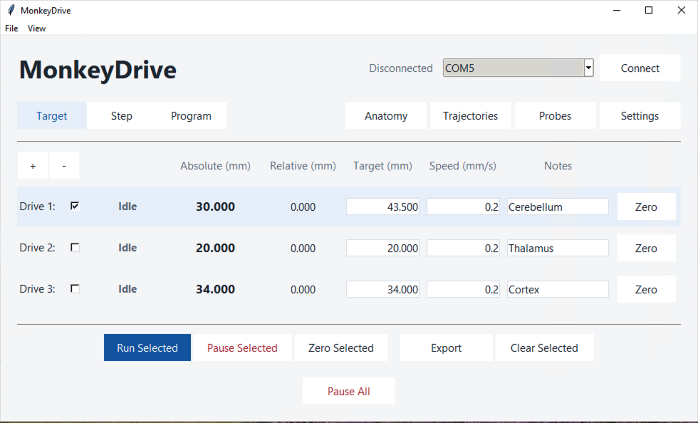
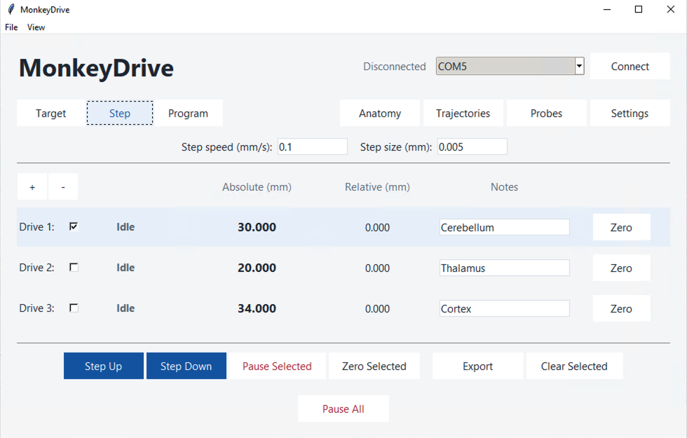
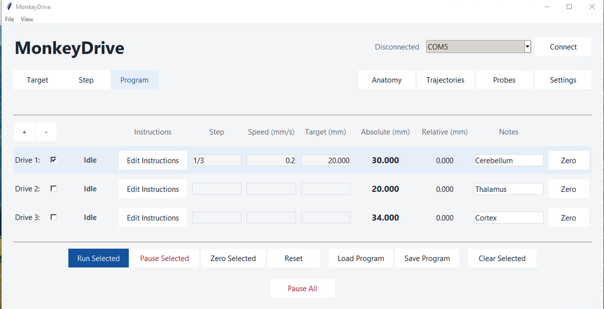
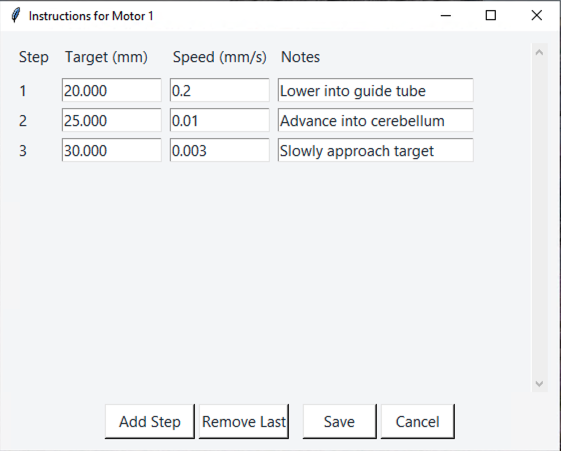
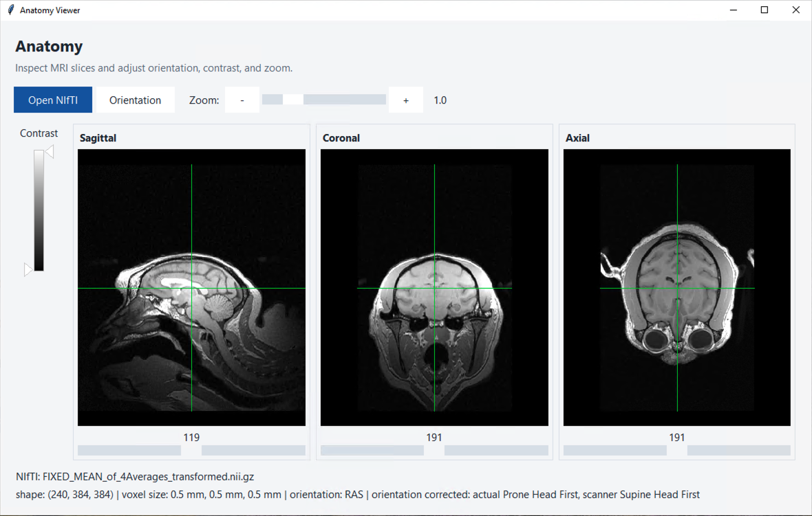
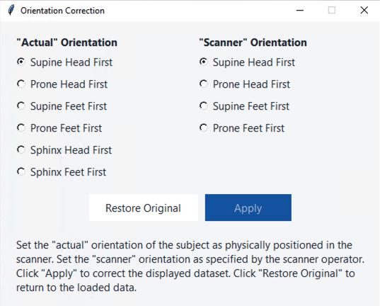
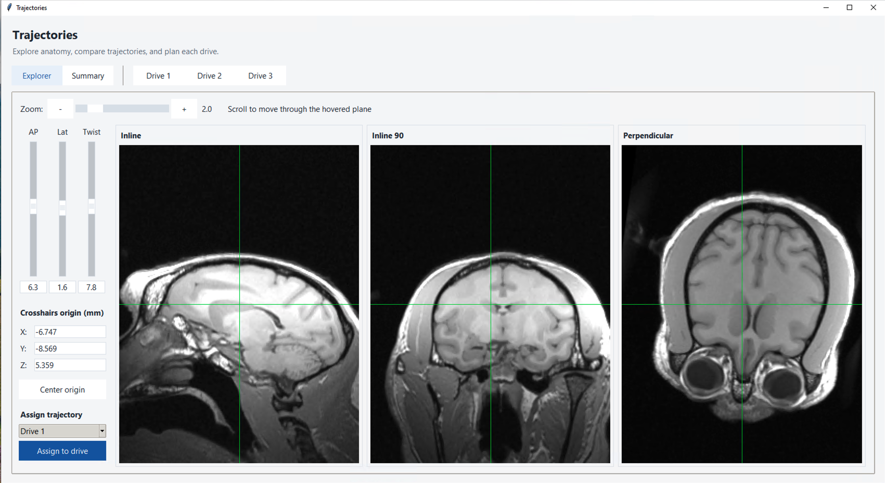
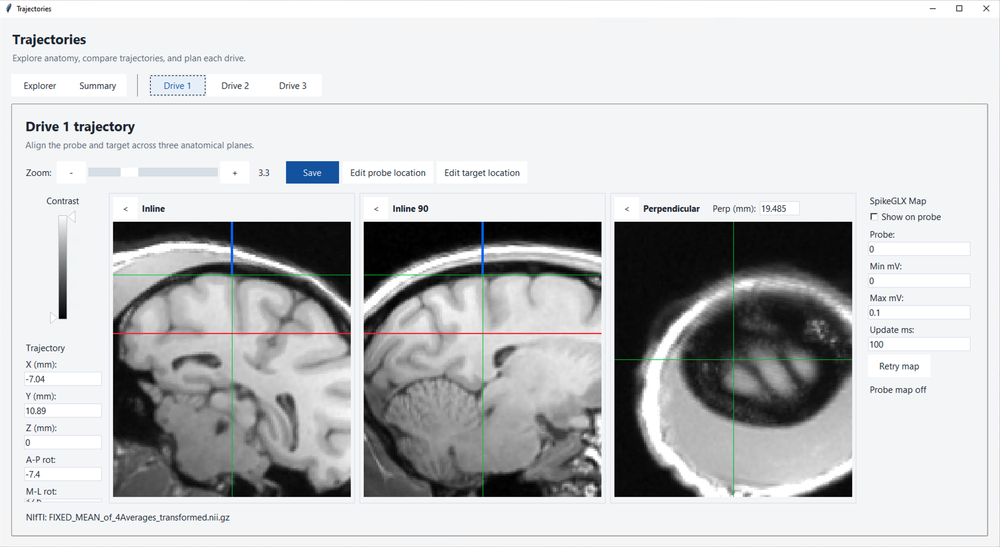

# OpenDrive GUI User Manual

This manual explains how to use the **full OpenDrive GUI** on Windows and macOS. Start with the first two sections to open the application, connect the console, and prepare your drive rows. The later sections cover movement modes, MRI and trajectory planning, the SpikeGLX display, and saving your work.

The full application requires the matching full-app firmware. You can open the anatomy and trajectory viewers without a console. For hardware assembly and console instructions, see the [OpenDrive system documentation](https://docs.google.com/document/d/1CwdIq8lv9Gtcey1GMihnH131U_tzeRZlZ0cmyOJbvFY/edit).


## 1. Getting started

### Install and open the GUI

The full application requires Python 3.10 or newer with Tkinter. For installation, follow the current [repository README](../README.md#install-and-launch). The commands below assume that you have already cloned the repository and installed its Python requirements.

From the repository folder, start the GUI using the command for your operating system:

**Windows PowerShell**

```powershell
.\.venv\Scripts\python.exe software/opendrive_gui.py
```

**macOS Terminal**

```sh
.venv/bin/python software/opendrive_gui.py
```

If your virtual environment has a different name, use its Python executable in place of `.venv`. When the GUI opens, it normally restores the workspace from your last session.

### What the position readouts mean

OpenDrive displays positions in millimeters. **Absolute** is the position used for target commands; **Relative** is the distance from a reference you choose. The GUI and console track commanded motor steps; they do **not** measure the carriage with a position encoder.

Before moving, confirm the physical drive position and direction. Check the position again after a restart, reconnect, or interruption. Keep the carriage away from its physical travel stops and test movement and stopping before using a probe. The GUI's standard absolute-position range is 0–50 mm. A saved position or trajectory overlay is not proof of the physical probe location.

### Connect the console

1. Select the console's serial port in the dropdown at the upper right. Click the dropdown to refresh its list. Windows ports generally appear as `COM` followed by a number; macOS ports often begin with `/dev/cu.usbmodem`.
2. Click **Connect**. The GUI checks that the console reports the expected full-app firmware version and receives a heartbeat response. Wait for the connection status to show **Connected**.
3. Before commanding movement, confirm the correct drive rows are shown and check each physical carriage position. Then [enter the corresponding absolute position](#set-an-absolute-position) in the GUI.

If the GUI displays **Firmware Update Required**, the console reported an incompatible version or did not report a version. Follow the sketch path in the warning, upload the matching full-app firmware from this version of the repository, then reconnect. The GUI does not enable movement until it verifies compatible firmware. If the port is absent or cannot be opened, check the USB connection and close other applications using that port.

Click **Disconnect** to end the connection, which will also pause any moving drives.

## 2. Preparing and monitoring drives

### The main window

Each drive has a row with a selection checkbox, a position readout, notes, and controls appropriate to the selected mode.



*The main window in Target mode. Positions, targets, speeds, and notes shown are examples.*

- **Drive number:** corresponds to the numbered channel on the console cable.
- **Checkbox and blue row highlight:** indicate a selected drive. Most movement and editing buttons act on the selected drives.
- **Running / Idle:** indicates whether the GUI believes a drive is running or idle.
- **Absolute:** the position used for absolute target commands.
- **Relative:** distance from the relative zero point you set for that drive.
- **Notes:** a short preview of the drive's editable notes.
- **Zero:** resets that row's relative position, whether or not its checkbox is selected.

The buttons below the rows change with the movement mode. **Pause All** stays on its own row at the bottom and stops all drives regardless of selection.

### Show, hide, and select drives

Use **+** above the drive rows to show another drive, up to six. Use **−** to hide the last row. Hiding a drive pauses it and retains its positions, notes, instructions, and trajectory; use **+** to bring it back.


### Positions and notes

#### Set an absolute position

1. Check the actual carriage position on the drive using the ruler.
2. Double-click the drive's **Absolute** value. The field becomes editable.
3. Enter the position in millimeters and press **Enter**, or move focus out of the field. The field returns to read-only display.

The GUI pauses a drive before allowing its absolute position to be edited. Entering a new absolute value also resets that drive's relative position to zero. It does not physically move the drive. If the value is outside the displayed range, the GUI rejects it.

#### Set or edit the relative reference

The relative position tracks distance from a reference you choose. To set the current position as zero, click **Zero** at the end of that drive's row, or select several drives and click **Zero Selected**. This changes the relative reference only; it does not move the drive or alter the absolute position.

To assign a specific relative value instead, double-click **Relative**, enter the value, and press **Enter**.

#### Add notes

Double-click a drive's **Notes** field to open its notes window. Enter or edit the text and close the window to save it to that drive. The row shows a shortened preview; reopen the window to see the full note. Notes are included in workspace saves and CSV exports.

### Clear selected drives

**Clear Selected** asks for confirmation, pauses the selected drives, and clears their displayed speed, target, absolute and relative positions, relative reference, notes, and program instructions. Clearing a value does not physically reposition a drive. Re-enter the measured absolute position before moving again.

## 3. Moving drives

Choose a mode according to the movement you want:

| Mode | Use it to | Values you enter |
| --- | --- | --- |
| **Target** | Move to an absolute position | A target and speed for each drive |
| **Step** | Move a fixed distance, or jog | A shared step size and speed |
| **Program** | Run a sequence of movements | A list of targets and speeds for each drive |

Before using any mode, select the intended drives and confirm their physical positions, direction of travel, and speed settings. The controls for stopping movement are the same across modes and are described first below.

### Pause movement

- **Pause Selected** requests a stop for selected drives. In the full GUI, the **End** key does the same.
- **Pause All**, at the bottom of the window, sends a console-wide stop regardless of selection.

If communication between the GUI and the console is lost, the drives will stop automatically. In the rare case that drives continue to move despite a lost connection, unplug the power cable from the console to stop all drives.

### Target mode

Use **Target** mode when you know the absolute position each drive should reach.

1. Click **Target** and check the drives you want to move.
2. For each selected drive, enter a **Target (mm)** and **Speed (mm/s)**. The target is an absolute position, not a distance to move from the current position.
3. Verify the selected rows, current absolute positions, target values, speeds, and intended direction.
4. Click **Run Selected**.
5. Watch the position readouts and the Running/Idle indicators. Click **Pause Selected** to stop selected drives, or **Pause All** to stop every drive.

The GUI checks the selected drives' inputs before sending target commands. Speed must fall within the limits in **Settings**, and the absolute position and target must be within the GUI's configured travel range.

### Step mode

Use **Step** mode to move selected drives by a shared increment.



*Step mode uses the shared speed and step size shown above the drive rows.*

1. Click **Step** and select the drives.
2. Double-click **Step speed (mm/s)**, enter a speed, and press Enter. Do the same for **Step size (mm)**. The minimum accepted step size is 0.001 mm, and positions are displayed to three decimal places.
3. Click **Step Up** to move toward a smaller absolute position or **Step Down** to move toward a larger absolute position. Each press requests one step at the chosen speed.

Step commands use the current position and do not overwrite the saved Target-mode destination. The GUI rejects a step that would produce a target outside its allowed range.

In the main window, a brief **−** or **+** key press requests one step; holding the key transitions to continuous jogging. Release the key to stop the jog.

### Program mode

A program is a list of absolute targets and speeds for each drive. A selected drive follows its own instructions in order.



*Program mode shows instruction controls and progress for each drive.*

1. Click **Program**.
2. In the desired drive row, click its **Edit Instructions** button. The editor contains columns for **Target (mm)**, **Speed (mm/s)**, and **Notes**.
3. Enter an absolute target and speed for each instruction step. Use **Add Step** to add another row or **Remove Last** to remove the final row. Step notes are optional.
4. Click **Save** in the instruction editor. Repeat for any other drives you want to program.
5. Select the intended drives, check their current positions and instructions, then click **Run Selected**. The GUI displays the active step, speed, and target in each row.



*Example instruction editor. Each row specifies an absolute target and a speed.*

**Pause Selected** pauses the selected drives and their program progress. Click **Run Selected** to continue the selected paused programs. **Pause All** pauses all drives. **Reset** pauses the selected drives and returns their program progress to the first step; use it before running a completed program again. Reset does not itself run a drive.

To reuse instructions later, see [Save or load a program](#save-or-load-a-program).

### Edit motion settings

Click **Settings** to review or edit the **Minimum speed**, **Maximum speed**, and **Backlash** values. Speeds are in mm/s and backlash is in mm.

These settings affect motion across drives. Use values appropriate to the connected system and confirm them against the system documentation before changing them.

## 4. Compact View

Choose **View → Compact View** to reduce the space occupied by the main window. The compact display shows each displayed drive's selection checkbox, absolute and relative position, connection status, and active mode.

**Run Selected** uses the target or program already configured in the full GUI. It is disabled in Step mode. **Pause All** remains available for all drives. Click **Expand** to return to the full GUI. Switching views does not itself pause an existing movement or program. The Run and jog keyboard shortcuts are disabled in Compact View.

## 5. Anatomy and trajectory planning

OpenDrive supports integration with anatomy data and spikeGLX.

### Load and inspect anatomy

The Anatomy viewer accepts NIfTI files (`.nii` or `.nii.gz`).



*The Anatomy viewer displays three orthogonal MRI planes.*

1. Click **Anatomy** in the main window.
2. Click **Open NIfTI** and choose the MRI file. Wait for the sagittal, coronal, and axial images to appear.
3. Scroll over a plane or use its slice control to inspect different slices. The crosshairs identify the positions of the other displayed slices.
4. Use the **Zoom** slider or **− / +** buttons to change image magnification. Adjust the **Contrast** handles to change the displayed intensity range.

If the displayed orientation does not match the acquisition and subject setup, click **Orientation**. Select the appropriate **Actual** and **Scanner** orientations and click **Apply**. **Restore Original** removes the correction. Confirm the orientation against known anatomy and the scan information before using an image for trajectory planning.



*Choose orientations that match your own subject and scan; the selections shown are examples.*

### Trajectory viewer

Once an MRI is loaded, click **Trajectories** in the main window. The Trajectories window opens on **Explorer**, with **Summary** and individual **Drive** tabs alongside it.

#### Explorer

The explorer allows you to translate and rotate the planes to aid with trajectory planning and visualization. Use the **AP**, **Lat**, and **Twist** vertical sliders or enter angles in degrees in the boxes beneath them to rotate the displayed trajectory. Enter the crosshairs origin **X**, **Y**, and **Z** in millimeters, or click **Center origin** to return the origin to the volume center. Press Enter or leave a field to apply an entered value.



*Explorer displays the Inline, Inline 90, and Perpendicular planes around a shared origin.*

Scroll over an image to move the shared origin through the hovered plane, along that plane's normal. The other two views update to reflect the new origin. Use the Zoom control to adjust magnification.

To use the current Explorer geometry for a drive, choose the drive under **Assign trajectory** and click **Assign to drive**. This copies the current origin, rotations, and zoom to the selected drive's trajectory. It does **not** move a motor. Open that drive's tab to check the resulting geometry and set the probe and target locations.

#### A drive's trajectory

Click **Drive 1**, **Drive 2**, and so on to open the corresponding drive view. The sidebar contains **X**, **Y**, **Z**, **A-P rot**, **M-L rot**, and **Twist** fields. Edit them and press Enter or click **Save**. Use the **< / >** controls to collapse or reopen an individual plane, and use the viewer's Zoom and Contrast controls to adjust the display.



*An individual drive trajectory with the blue probe marker and red target marker set.*

To relate the image to the physical probe:

1. With the probe-location marker unset, scroll over the **Perpendicular** plane or edit **Perp (mm)** to move that plane to the current estimate of the probe's location.
2. Click **Set probe location**. The viewer records the current plane and the GUI's current motor position as the reference. The blue marker then tracks subsequent reported motor-position changes.
3. The viewer allows target positions to be set using MRI coordinates. Click **Set target location**, scroll over an Inline view to place the red target line, and click **Finish target location**. The corresponding target position in the main window will update accordingly.
4. To change the probe reference later, click **Edit probe location**, reposition the perpendicular plane, and click **Set probe location** again. Use **Edit target location** to adjust a saved target.

As the corresponding drive moves, the estimated probe position and the perpendicular slice will update accordingly.

#### Summary viewer

Click **Summary** to view trajectories for all drives. This is useful for keeping track of progress when using multiple drives. Each drive has its own tile and **Inline / Inline 90** selector. Probe and target markers reflect the corresponding drive trajectory and reported position. Use a drive tab when you need to edit that drive's trajectory or references.

## 6. SpikeGLX integration

Click **Probes** to open the live probe activity summary. With a compatible SpikeGLX SDK and command server available, the window displays live per-channel amplitude maps. Adjust **Min mV**, **Max mV**, and **Update ms**, then click **Apply**; **Retry** attempts the connection again. The status text reports connection or data problems.

An individual drive's trajectory view also has a **SpikeGLX Map** section. Enable **Show on probe**, choose the probe number, and set the amplitude scale and update interval. **Retry map** restarts that map connection. A map needs a running, accessible SpikeGLX stream and the SDK used by OpenDrive. If it shows waiting or unavailable, check SpikeGLX acquisition and command-server settings, then retry.

## 7. Saving, loading, and exporting

OpenDrive automatically saves its workspace as you work and restores it at startup. You can also save files for a specific purpose:

| File | What it contains | How to create it |
| --- | --- | --- |
| **Configuration** (`.json`) | The workspace, including positions, notes, programs, settings, trajectory information, and a reference to the MRI | **File → Save Config...** |
| **Program** (`.csv`) | The displayed drives' movement instructions | **Save Program** in Program mode |
| **Export** (`.csv`) | A timestamped snapshot of displayed drive values and notes | **Export** in Target or Step mode |


### Save or load a configuration

To save a named configuration, choose **File → Save Config...**, select a location and filename, and save the JSON file. The configuration includes drive positions and relative references, programs, notes, trajectories, Explorer settings, console settings, view preference, and the anatomy path and orientation.

To restore one, choose **File → Load Config...**, select the file, and wait for the load confirmation. Loading replaces the current workspace and disconnects the console first. It does not move motors or automatically resume programs. Open viewers are refreshed. If the MRI is unavailable at the stored path, reopen it in Anatomy before using trajectory views.

The Save Config and Load Config dialogs pause running drives before opening, even if you cancel the dialog. Loaded position numbers are stored values, not physical measurements; check the carriages before moving.

### Save or load a program

In Program mode, click **Save Program** to write the displayed drives' instructions to a CSV file. Click **Load Program** and choose a file or a recent program to load it. Loading validates the file, pauses running drives, replaces the current displayed drives' instructions, and resets program progress. A program file holds instructions; use a named configuration if you also want the rest of the workspace.

The program CSV uses the columns `motor`, `step`, `target_mm`, `speed_mm_s`, and `notes`. The required columns are `motor`, `target_mm`, and `speed_mm_s`. A motor listed in the file must already have a row in the GUI. Load a program without pressing Run if you only want to inspect it.

### Export a drive snapshot

In Target or Step mode, click **Export** and choose a CSV filename. The GUI pauses running drives before opening the save dialog. The file contains a timestamp, drive number, speed, target, absolute position, relative position, and notes for the displayed drives. This snapshot does not replace a configuration or program file.

## 8. Keyboard shortcuts

| Shortcut | Action | Where it works |
| --- | --- | --- |
| **Ctrl+Enter** on Windows / **Cmd+Enter** on macOS | Run Selected | Full GUI in Target or Program mode |
| **End** | Pause Selected | Full GUI |
| **1–6** on the number row or keypad | Select one displayed drive | Step mode, outside editable text fields |
| **− / +** | Step Up / Step Down; hold to jog and release to stop | Step mode, outside editable text fields |

Step shortcuts only work when focus is on the main window.

## 9. Troubleshooting

### The console does not connect

Refresh the port dropdown, check the USB connection, and close other applications using the port. If the GUI says **Firmware Update Required**, upload the matching full-app sketch identified in the warning, then reconnect. A lost connection pauses GUI program progress and stops all drives.

### The position is not changing

After a direction reversal, the console compensates for mechanical backlash before reporting carriage movement. The GUI currently has no separate backlash-compensation indicator, so an unchanged readout alone does not establish that the motor is stopped. Also check the connection, selection, and whether the GUI shows Running or Idle.

### A drive paused when I opened a dialog

Some dialogs pause running drives before opening. Export and the configuration dialogs do so explicitly. Check the drive and program state before resuming.

### Trajectories is unavailable or the MRI is missing

Open Anatomy and load a NIfTI MRI first. A saved configuration contains the MRI's path, not the MRI itself; if that path is unavailable, locate and reopen the file.

### The probe activity display is waiting or unavailable

Check that SpikeGLX acquisition is running, its command server is accessible, and OpenDrive can find the compatible SDK. Click **Retry** in the probe summary or **Retry map** in the drive trajectory view.
